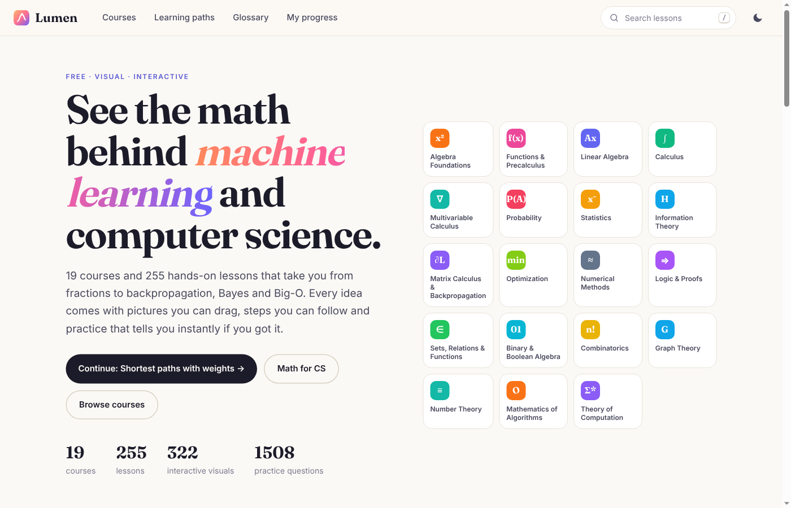
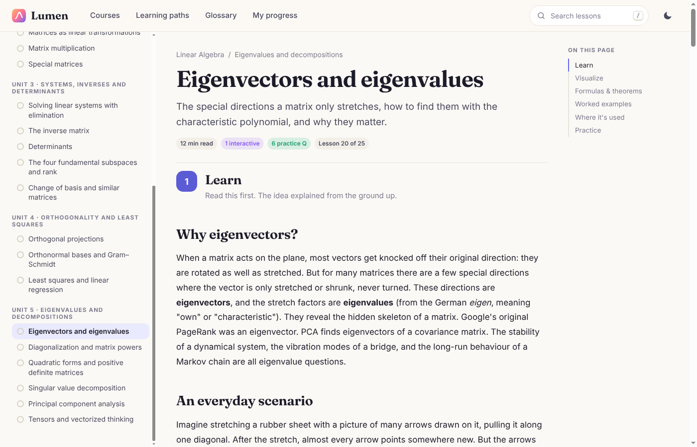
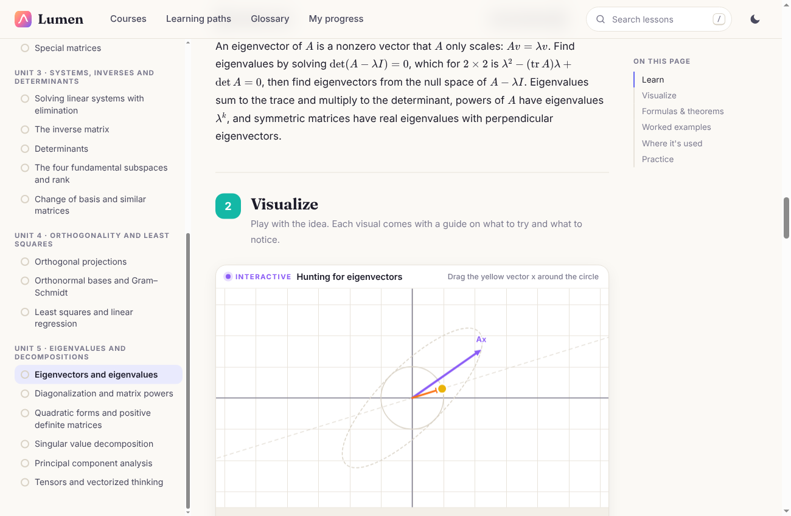
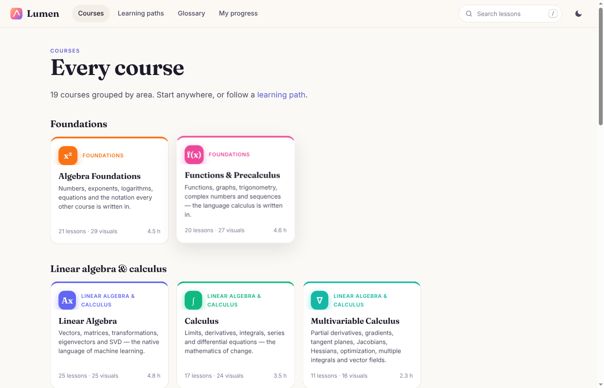
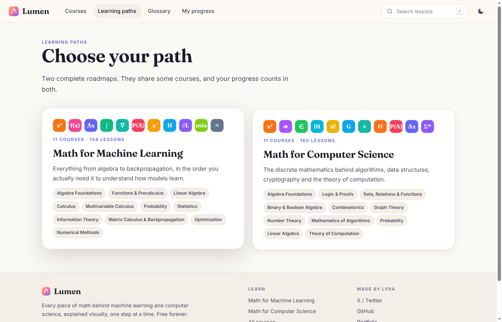
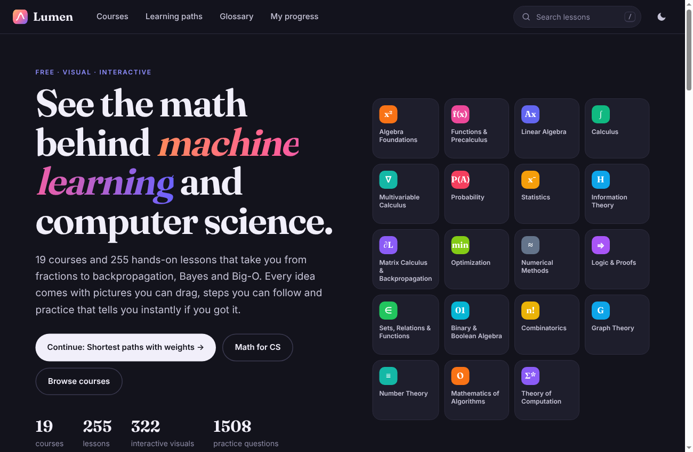
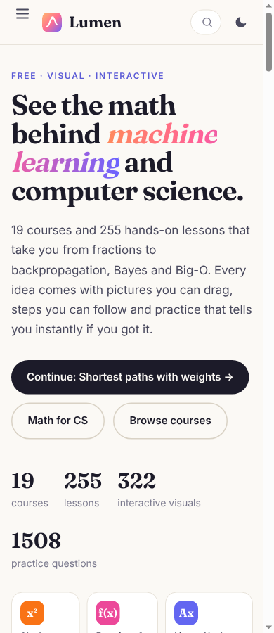

# ✨ Lumen

### See the math behind machine learning and computer science.

**[🌐 Open Lumen](https://lyra-4leafclover.github.io/lumen-math/)**

---

## 📖 What is Lumen?

Lumen teaches every piece of math you need for machine learning and computer science, from fractions all the way to backpropagation, Bayes, Big-O and the halting problem.

Every lesson works like a good textbook chapter with a playground attached. You read a full article first, then play with interactive visuals, then practise until it sticks.

## 🧭 How every lesson works

| Step | What you get |
|---|---|
| **1. Learn** | A full article (900+ words) that explains the idea from the ground up, with everyday examples and pictures in the text |
| **2. Visualize** | Interactive visuals you can drag, each with a "what to try" and "what to notice" guide |
| **3. Formulas & theorems** | The key results to remember, with proofs |
| **4. Worked examples** | Problems solved step by step, plus an exam-style question |
| **5. Where it's used** | How the idea shows up in machine learning, computer science and real life |
| **6. Practice** | A quiz where every answer comes with an explanation |

## 🌟 Features

| | |
|---|---|
| 🗺️ **Learning paths** | Two roadmaps: *Math for Machine Learning* and *Math for Computer Science* |
| 📝 **Mock tests** | 15 random questions from a whole course, with a score |
| 📋 **Formula sheets** | Every formula in a course on one page |
| 📚 **Glossary** | Every defined term, linked back to its lesson |
| 🔍 **Search** | Press `/` to search all lessons |
| ✅ **Progress tracking** | Lessons you finish are saved in your browser, no account needed |
| 🌙 **Dark mode** | One click, top right |
| 📱 **Works on phones** | Every page adapts to small screens |

## 🎓 Courses

| Area | Courses |
|---|---|
| **Foundations** | Algebra Foundations · Functions & Precalculus |
| **Linear algebra & calculus** | Linear Algebra · Calculus · Multivariable Calculus |
| **Probability & data** | Probability · Statistics · Information Theory |
| **ML math** | Matrix Calculus & Backpropagation · Optimization · Numerical Methods |
| **Discrete math** | Logic & Proofs · Sets, Relations & Functions · Binary & Boolean Algebra · Combinatorics · Graph Theory · Number Theory |
| **CS theory** | Mathematics of Algorithms · Theory of Computation |

## 📸 Screenshots

| Lesson article | Interactive visual |
|---|---|
|  |  |
| **All courses** | **Learning paths** |
|  |  |
| **Dark mode** | **On a phone** |
|  |   |

## 💡 Tips

- **New to the math?** Start with the *Math for Machine Learning* path. It begins with Algebra Foundations.
- **Already know some of it?** Jump straight to any course. Each course page says which courses help to take first.
- **Try every visual before you read its guide.** Then read "what to notice" to check what you saw.
- **Use the mock test** at the end of a course to see what you still need to review.

## 🗂️ What's inside

| Folder | What it holds |
|---|---|
| `index.html` | The website |
| `content/` | All 19 courses, written as text files |
| `js/` | The app, the interactive visuals and the course data |
| `css/` | The look of the site |
| `vendor/` | KaTeX, which draws the math formulas |
| `docs/` | Screenshots for this page |

---

Made by **Lyra** 🍀

[X / Twitter](https://x.com/Lyra_void) · [GitHub](https://github.com/Lyra-4leafclover) · [Portfolio](https://lyradossier.vercel.app/)

